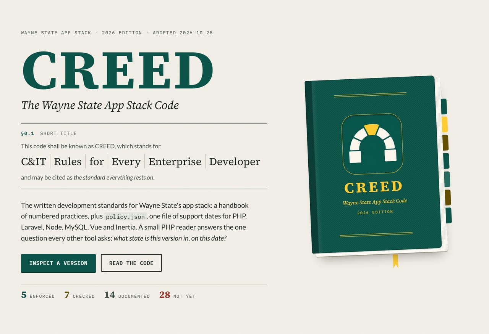
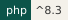
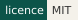
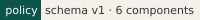
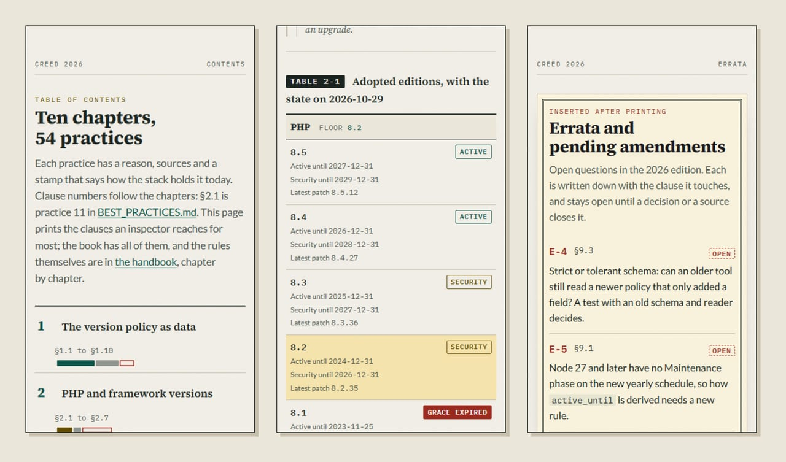
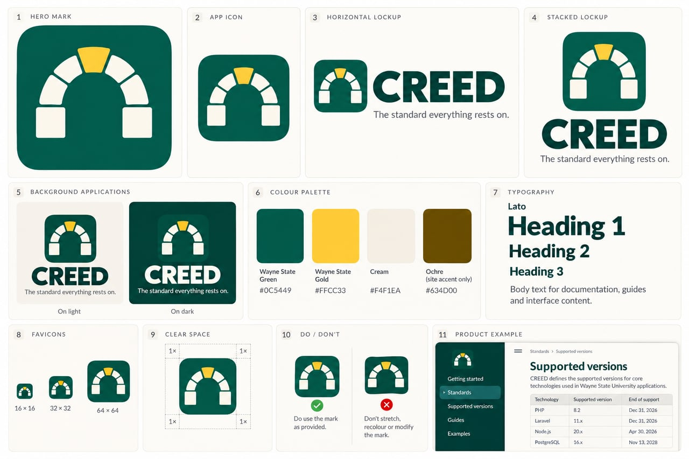

<div align="center">
  <a href="site/index.html"></a>
</div>

# CREED

<div align="center">
  
  
  
  <a href="https://github.com/waynestate/creed/actions/workflows/ci.yml"></a>
</div>

**The standard everything rests on.** The Wayne State App Stack Code: one policy file, one reader, and an
inspector who stamps what he finds.

Checks: `composer ci` (the same command runs on GitLab and GitHub).

Front page: [`site/index.html`](site/index.html), a static page you can open in a browser or serve from `site/`.
On Citadel it is served by the raw-PHP deploy layer in [`deploy/`](deploy/): a SQUIRE kit whose front controller serves `site/` behind HELMET's security headers. For local development, keep serving `site/` directly.

One command, two clouds, zero excuses. Higher.


CREED is the Wayne State app stack's version policy, as data. One file,
`policy/policy.json`, lists the support dates for PHP, Laravel, Node, MySQL,
Vue and Inertia, plus the rules every check runs against. A small
framework-free PHP reader, `Waynestate\Creed\Policy`, answers the one question
every tool needs: what state is this version in, on this date?

This repository is published from Wayne State University's internal GitLab
and mirrored here. Changes land there first; Wayne State developers open
issues and merge requests on the internal project.

No other code in the stack decides a version's state. The rules live in one
place, and every tool reads them from here.

## Install

```
composer require waynestate/creed
```

## Usage

```php
use Waynestate\Creed\Policy;
use Waynestate\Creed\State;

$policy = Policy::bundled();

// What state is PHP 8.2 in, on this date?
$state = $policy->stateOf('php', '8.2', new DateTimeImmutable('2026-10-27'));
// State::Security

// What is the oldest PHP an app may declare?
$floor = $policy->oldestSupported('php', new DateTimeImmutable('2026-10-27'));
// '8.2'
```

### Reading the policy from PHP

The reader's public members, one line each:

- `Policy::bundled()`, `Policy::fromFile($path)`, `Policy::fromArray($data)`: load a policy; `origin()` says where it came from.
- `stateOf($component, $version, $on)`: the state, or an exception; `tryStateOf()` is the same answer as `null` when it cannot be answered.
- `oldestSupported($component, $on)`: the lowest version still Active or Security; `supported()` lists all of them, oldest first.
- `latestPatch($component, $version)`: the current patch in that line; `latestPatchChecked()` says when it was last checked.
- `line($component, $version)`: the raw line, with `active_until`, `security_until`, `latest_patch`, `latest_patch_checked` (each a string or null) and `current` (true or null).
- `activeUntil()`, `securityUntil()`: those dates as `DateTimeImmutable`, or null.
- `daysToEol($component, $version, $on)`: whole days until `security_until`, signed; `isPastGrace()` says whether the grace period is over.
- `resolveVersion($component, $version)`: the policy line a full version like `8.3.12` belongs to.
- `isAheadOfPolicy($component, $version)`: whether a version sorts above every line the policy lists.
- `hasComponent()`, `components()`, `versions($component)`, `tools()`, `toolMinimum($tool)`, `rules()`: the shape of the policy itself.

One last time: the reader answers, it does not guess.

### With Arms Wide Open

The support window stays open until `security_until`. A version is still
`Security` on that day, moves to `Eol` the day after, and stays in `Eol` for
`eol_grace_days` (90) more days before it is `EolGraceExpired`. The boundary
is inclusive, and the reader never guesses.

<div align="center"></div>
<div align="center"><sub>Form CR-1, as the front page fills it in: four real rows of <code>policy/policy.json</code>, the same answers <code>Policy::stateOf</code> gives, stamped.</sub></div>

<details>
<summary><b>Read the rest of the book</b>: the contents, Table 2-1 and the errata slip, as printed on a phone</summary>
<br>
<div align="center"></div>
</details>

### Versions CREED hasn't heard of

The reader refuses what it does not know, except the newest thing. A version
that sorts above every line the policy lists is `Active`, and
`isAheadOfPolicy()` says so. A version that falls between listed lines is
still unknown, and still throws. Current versions are never refused.

A line marked `"current": true` is `Active` on every date and carries no
`security_until`: the policy says the line is current, and the reader does not
guess when it stops being so.

### Higher

CREED itself requires PHP `^8.3`, like every stack package, and CI tests it on
8.3, 8.4 and 8.5. The policy's floor for apps is a different number: `^8.2`
until PHP 8.2 reaches end of life on 2026-12-31, then `^8.3`. Creed has always
been one version ahead of everyone else, at least by his own account.

## Proof

**82 Wayne State applications read against CREED on 2026-10-28: 14 passed, 43 flagged, 0 tool errors.** The other
25 declare no version CREED can read (no `require.php`, no lock, no known image).

Every version an app declares or locks (its PHP floor, Laravel, Vue, Inertia and the PHP image it runs on) went
through `Policy::stateOf` with CREED 0.1.0 (commit `2d982ae`), inside `php:8.4-cli` with no network, against a
throwaway copy of each repository: 109 facts, 109 answers.

| Component | Active | Security | Past grace | Older than the policy lists | Facts |
|---|---:|---:|---:|---:|---:|
| PHP | 12 | 14 | 13 | 44 | 83 |
| Laravel | 2 | 2 | 5 | 8 | 17 |
| Vue | 5 | 0 | 0 | 0 | 5 |
| Inertia | 0 | 0 | 0 | 4 | 4 |

The apps are counted, never named. The full record, the command and what the run does not prove are on the proof
page: [`site/proof.html`](site/proof.html). Run it on your own app:

```
php -r 'require "vendor/autoload.php"; $p = Waynestate\Creed\Policy::bundled(); echo $p->stateOf("php", $p->resolveVersion("php", "8.2.29"), new DateTimeImmutable("2026-10-28"))->name, PHP_EOL;'
```

Creed Bratton has never once been audited. These 82 apps have.

## The handbook

The rules, chapter by chapter, live in [`handbook/`](handbook/README.md).

## Keeping the patches fresh

`bin/refresh-patches.php` re-reads the upstream feeds, rewrites the
`latest_patch` fields in `policy/policy.json`, and proposes new Vue lines from
endoflife.date. A scheduled CI job runs it every
Monday and fails the pipeline when the policy is stale; a person then runs the
tool and commits the result. CI never pushes. It only raises its hand.

The schedule is a GitLab project setting, not a file in this repo: someone
creates it under CI/CD > Schedules (weekly, Monday). The GitHub mirror runs the
same check on a cron and on demand.

## Carrying CREED in another package

PROCTOR, BOOSTER, ROLLCALL and ADVISOR each carry a generated copy of the
reader under their own namespace, so two tools in one app never fight over a
class name (the generator below keeps the copies in step). The copies began
because CREED was not on Packagist. It is now (`waynestate/creed` 0.1.0), so
each copy can become a real `require`, one consumer at a time; until a
consumer switches, its copy stays. CREED owns the generator and the check:

```
php bin/export.php --namespace=Waynestate\Proctor\Creed --to=vendor/creed-copy
php bin/export.php --check --namespace=Waynestate\Proctor\Creed --to=vendor/creed-copy
```

The copy is the reader with the namespace rewritten and `bundled()` repointed
at its own `policy.json`; `--check` fails when the copy drifts from the source.
Creed Bratton would have a form for this.

## Tests

Maintainers: how to build, test and release this project, and where its data comes from, is in [MAINTAINING.md](MAINTAINING.md).

No PHP on the machine? Fine. Docker runs the suite:

```
docker run --rm -v "${PWD}:/app" -w /app composer:2 composer install --no-interaction
docker run --rm -v "${PWD}:/app" -w /app php:8.4-cli vendor/bin/phpunit
docker run --rm -v "${PWD}:/app" -w /app php:8.3-cli vendor/bin/phpunit
```

The policy validates against its schema:

```
docker run --rm -v "${PWD}:/app" -w /app composer:2 composer validate-policy
```

## Strongly recommended: a git.wayne.edu instance runner

git.wayne.edu has no runners today. Every product in the stack strongly
recommends a git.wayne.edu instance runner.


Creed Bratton, whose quality assurance work we all admire. His past is a
mystery. Ours is in `policy/policy.json`, where it belongs.

<details>
<summary><b>The brand board</b>: the keystone arch, the lockups, the cloth, the ink and the type</summary>
<br>
<div align="center"></div>
</details>

<div align="center"><b>Authorities having jurisdiction</b><br><sub>WayneUI and the stack. Every one of them reads its dates from here.</sub></div>

<div align="center">
  <a href="https://github.com/waynestate/wayne-ui" title="WayneUI"></a>
  <a href="https://github.com/waynestate/creed" title="CREED"></a>
  <a href="https://github.com/waynestate/proctor" title="PROCTOR"></a>
  <a href="https://github.com/waynestate/sesame" title="SESAME"></a>
  <a href="https://github.com/waynestate/helmet" title="HELMET"></a>
  <a href="https://github.com/waynestate/sourdough" title="Sourdough"></a>
  <a href="https://github.com/waynestate/squire" title="SQUIRE"></a>
  <a href="https://github.com/waynestate/preflight" title="PREFLIGHT"></a>
  <a href="https://github.com/waynestate/pinstripe" title="Pinstripe"></a>
  <a href="https://github.com/waynestate/booster" title="BOOSTER"></a>
  <a href="https://github.com/waynestate/rollcall" title="ROLLCALL"></a>
  <a href="https://github.com/waynestate/drawbridge" title="DRAWBRIDGE"></a>
  <a href="https://github.com/waynestate/advisor" title="ADVISOR"></a>
  <a href="https://github.com/waynestate/weld" title="WELD"></a>
</div>

<div align="center"><sub>Images are regenerated from the front page and the policy by <a href="scripts/readme-art/README.md"><code>scripts/readme-art</code></a>. Inspected, stamped, and filed one version ahead.</sub></div>
