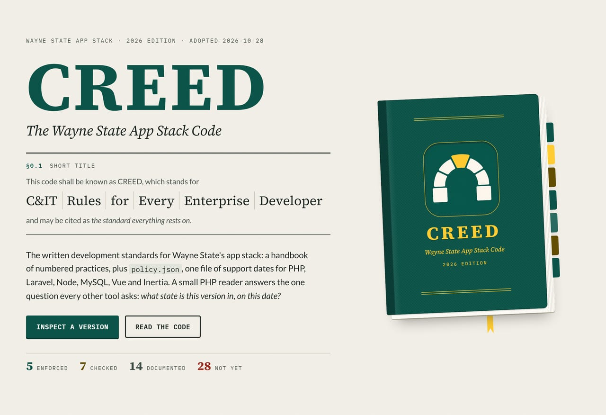
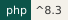

[](../index.html)

# CREED




**The standard everything rests on.**

**Not to be confused with:** CREED is the rules; PROCTOR checks an app against them.

This page orients you: what CREED is, what it ships, and where to go next.

CREED is the Wayne State app stack's version policy, as data. One file,
`policy/policy.json`, lists the support dates for PHP, Laravel, Node, MySQL,
Vue and Inertia, plus the rules every check runs against. A small
framework-free PHP reader, `Waynestate\Creed\Policy`, answers the one question
every tool needs: what state is this version in, on this date?

## Usage

```php
use Waynestate\Creed\Policy;
use Waynestate\Creed\State;

$policy = Policy::bundled();

// What state is PHP 8.2 in, on this date?
$state = $policy->stateOf('php', '8.2', new DateTimeImmutable('2026-10-27'));
// State::Security

// What is the oldest PHP an app may declare?
$floor = $policy->oldestSupported('php', new DateTimeImmutable('2026-10-27'));
// '8.2'
```

## Pick your path

- [Quick start](guides/quick-start.md): the shortest path from `composer require` to a stamped answer.
- [Install](install.md): require the package, verify the bundled policy, develop on it.
- [Reader API](reference/api.md): every public member of the reader, one line each.
- [Handbook](guides/handbook.md): the rules, chapter by chapter.

Status: version 0.1.9, MIT license.

Agents: fetch [https://creed.apps.wayne.edu/llms.txt](https://creed.apps.wayne.edu/llms.txt).

One command, two clouds, zero excuses. Higher.


## Related

- [Install](install.md)
- [Quick start](guides/quick-start.md)
- [Reader API](reference/api.md)
- [Contributing](contributing.md)
- [Changelog](changelog.md)
